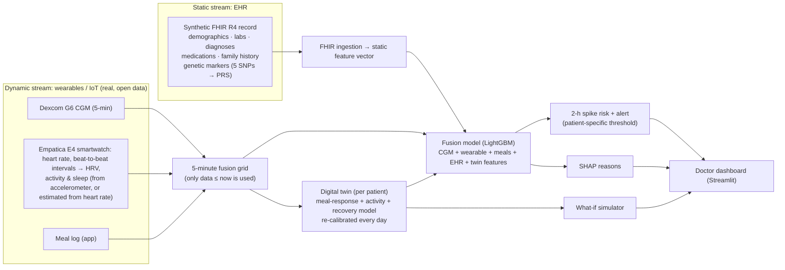

# GlucoTwin

### A patient digital twin that warns of glucose spikes 2 hours ahead by fusing health records with wearable data

> Happiest Health **Digital Twin Challenge 2026** · Phase 1: Prototype & Code Submission

---

## 1. Team details

| | |
|---|---|
| **Team name** | Uno |
| **Team leader** | Varsha B S Acharya |
| **College** | RV University, Bengaluru |
| **Team size** | 1 |

## 2. Project title

**GlucoTwin: EHR + wearable fusion for 2-hour-ahead glucose-spike prediction, with a calibrated per-patient digital twin and a doctor dashboard**

## 3. Problem statement and healthcare use case

India has an estimated **101 million people with diabetes and 136 million with prediabetes** (ICMR-INDIAB national survey, 2023). In prediabetes, repeated **post-meal glucose spikes** are an early, modifiable warning sign, but a doctor sees the patient a few times a year, and a CGM only reports a spike once it is already happening.

**Use case.** A doctor (or care team) monitors a panel of prediabetic patients who wear a CGM and a smartwatch and log meals in an app. GlucoTwin:

1. **Mirrors** each patient: one virtual patient built from their health record (static) and their live sensor streams (dynamic).
2. **Predicts** an adverse event: *glucose will cross 140 mg/dL within the next 2 hours*. 140 mg/dL is the 2-hour OGTT cut-off for impaired glucose tolerance.
3. **Explains** each alert in plain language, e.g. "large lunch logged · short sleep last night · low activity".
4. **Simulates** what-ifs with the patient's own calibrated physiology, e.g. *"if she walks 15 minutes after lunch, her projected peak falls from 168 to 152 mg/dL"*.

## 4. Demo video

▶️ **✏️ unlisted YouTube link** (≥ 20 minutes)

## 5. How it works



Full diagram (PDF): [`docs/architecture.pdf`](docs/architecture.pdf)

### Clock alignment: making sure the streams line up
The CGM, the wristband and the phone meal log each keep their own clock, and in the public dataset they don't always agree. Before modelling, `src/align.py` checks each person and prints a report (also in the dashboard's *Data & compliance* page):
- **Wristband vs CGM.** Heart rate and glucose are both quiet at night and busy by day. The shift that best lines up the two 24-hour patterns, pooled over all participants, gives the wristband's clock offset.
- **Meal log vs CGM.** Glucose should rise 40–80 min after a carb meal. Meal-time offsets of ±2 h are tested, and one is kept only if it clearly strengthens that rise (for example, meals logged an hour late).
- **Meal-log coverage.** If a person's logged meals fall outside their CGM recording, the meal log is marked *unavailable*, so the model doesn't read it as "never ate".

On a test copy with deliberately broken clocks (wristband +5 h, meals logged an hour late, one log from another fortnight), the step recovered every offset exactly. AUROC went back from the misaligned level to within 0.01 of the clean data.

### The digital twin, in one equation
For each patient, glucose is modelled as

$$G(t) = G_{base}(t) + k\sum_{meals} C_i\,h(t-t_i;\,t_p) - a\,A(t) + D\,e^{-\Delta t/t_r}$$

where $h$ is a hump-shaped meal response that peaks at $t_p$ minutes, $A$ is smoothed wrist activity, and $D$ is any unexplained deviation, which fades with recovery time $t_r$.
The four numbers **(k, tp, a, tr)** are the patient's twin: carb sensitivity, time-to-peak, activity benefit, and recovery.
- They start from population values and are **re-fitted every day on that patient's past data only** (MAP estimation with a population prior), so the twin learns the person.
- The twin then feeds the ML model with forecast features (projected peak, projected rise) and powers the what-if simulator.

## 6. Technical stack and models

| Layer | Tools |
|---|---|
| Language | Python 3.10+ |
| Data | pandas, NumPy (chunked streaming of multi-GB sensor CSVs) |
| EHR interoperability | HL7 **FHIR R4** bundles (LOINC, SNOMED CT, RxNorm codes), the standard used by India's ABDM |
| Digital twin | Physiological model fitted with SciPy `least_squares` (bounded MAP with population prior) |
| Prediction | **LightGBM** gradient-boosted trees (handles missing sensor data natively) |
| Explainability | SHAP (TreeSHAP), global and per-alert |
| Validation | **Leave-one-subject-out** cross-validation; alert thresholds chosen by inner CV on training patients only |
| Dashboard | Streamlit + Plotly |

**Features (≈60):**
- **CGM:** level, 15/30/60-min change, trend, acceleration, variability, personal baseline.
- **Wearables:** heart rate, HRV (RMSSD), activity over 15 min, 1 h and 3 h, previous-night sleep duration, sleep heart rate and sleep HRV. Skin temperature and EDA are used when downloaded.
  - Each signal is measured **relative to that person's own normal** (their trailing 3 days, past data only). Raw levels differ far more between people than within a person, so raw values mostly tell a model *who* someone is, which doesn't carry over to a new patient.
  - Activity comes from the accelerometer when available. Otherwise it is estimated from heart rate above the person's resting level (`src/load_data.py`), which works with any watch that reports heart rate.
- **Meals:** time since the last meal, its carbs, sugar, fat, protein and fibre, and carbs in the last 3 h.
- **EHR:** age, sex, BMI, HbA1c, fasting glucose, lipids, blood pressure, diagnoses, medications, family history, polygenic risk score.
- **Twin:** projected 2-h peak, projected rise, projected glucose in 1 h, and the meal effect still active. Only the twin's time-varying *forecasts* go into the model. Its personal parameters are constant within a person, so they would act as an ID card for that person.

## 7. Results

Run on the BIG IDEAs dataset: 16 participants, about 38,000 five-minute rows, of which 22% are followed by a spike within 2 h. **Every number comes from a model that never saw the patient it is scoring** (leave-one-subject-out). Alert thresholds were chosen on the training patients only.

| Data used | AUROC | AUPRC | Spikes warned in advance | Median warning | False alarms / day |
|---|---|---|---|---|---|
| Rule: CGM trend extrapolation | 0.612 | 0.308 | 99% | 75 min | 6.8 |
| CGM only (ML) | 0.680 | 0.407 | 90% | 10 min | 1.7 |
| + Wearables | 0.658 | 0.364 | 88% | 10 min | 2.3 |
| + Meal log | 0.717 | 0.477 | 89% | 40 min | 2.1 |
| **+ EHR (full fusion)** | **0.733** | **0.490** | **86%** | **40 min** | **1.9** |
| + Digital twin forecasts | 0.721 | 0.476 | 87% | 40 min | 2.0 |

*AUPRC baseline (random guessing) = 0.22. "Spikes warned in advance" = share of spikes preceded by at least one alert in the 2 hours before.*

**What the results show**
- **Fusion helps.** Going from glucose alone to the full fusion of glucose, wearables, meals and health record raises AUROC from 0.680 to **0.733** and AUPRC from 0.407 to **0.490**. The meal log adds the most.
- **Fewer false alarms than a basic CGM alarm.** Extrapolating the glucose trend catches almost every spike but raises **6.8 false alarms a day**, which leads to alarm fatigue. The fusion model warns of 86% of spikes with **1.9 false alarms a day**, a median of 40 minutes ahead.
- **Wearables alone don't add over CGM** in this build, because without the accelerometer, activity is estimated from heart rate. They contribute inside the full fusion.
- **The digital twin's value is personalisation and simulation.** Adding its forecasts as model inputs didn't improve the score further (0.721 vs 0.733; with 16 people this difference is within noise). The twin is what lets a doctor ask *"what if she walks after lunch?"*, and it was not tuned to improve the score.

**Clock alignment on the real data:** the wristband and CGM clocks agreed, so no shift was needed. One participant's meal times were shifted (016, +105 min). One participant's meal log (015) fell entirely outside their CGM recording, so it was marked unavailable.

| | |
|---|---|
|  |  |
|  |  |
|  |  |

## 8. Doctor dashboard

```bash
streamlit run app/dashboard.py
```
- **Ward overview:** every patient sorted by risk, with status icon and label (🔴 Alert / 🟠 Watch / 🟢 Stable / 🩸 In spike), glucose and trend arrow, last meal, and the main reason.
- **Patient twin:**
  - health-record card and alert banner with reasons
  - a multi-day timeline of glucose, risk, HR, HRV, activity and sleep
  - the twin's personal parameters
  - the **what-if simulator** (meal size × post-meal walk)
- **Model performance:** the ablation, ROC, alert trade-off and SHAP figures.
- **Data & compliance:** data provenance and a viewer for each patient's FHIR record.
- A **replay clock** walks through the recorded week as if live. Predictions never use data after the clock time.

Live demo: ✏️ Streamlit Community Cloud link

## 9. Data and sandbox compliance (DPDP Act / HIPAA)

No real patient records are used.

| Stream | Source | Real or synthetic |
|---|---|---|
| CGM, smartwatch (heart rate, beat-to-beat intervals), food logs, sex, HbA1c | [BIG IDEAs Lab Glycemic Variability and Wearable Device Data](https://physionet.org/content/big-ideas-glycemic-wearable/), PhysioNet, **open access** (Open Data Commons Attribution License v1.0) | Real, de-identified |
| Age, labs, diagnoses, medications, family history, genetic markers | Generated by `src/ehr.py`, consistent with each person's real HbA1c | **Synthetic** |

The raw dataset is not redistributed in this repository. Download it from PhysioNet (see below).

**Citations**
- Dataset: Cho, P., Kim, J., Bent, B., & Dunn, J. (2023). *BIG IDEAs Lab Glycemic Variability and Wearable Device Data* (version 1.1.2). PhysioNet. https://doi.org/10.13026/zthx-5212
- Original study: Bent, B., Cho, P.J., Henriquez, M. et al. Engineering digital biomarkers of interstitial glucose from noninvasive smartwatches. *npj Digital Medicine* 4, 89 (2021). https://doi.org/10.1038/s41746-021-00465-w
- PhysioNet: Pollard, T. et al. (2026). PhysioNet as a global platform for biomedical research. *Nature Health*. https://doi.org/10.1038/s44360-026-00096-z
- Prevalence figures: Anjana, R.M. et al. Metabolic non-communicable disease health report of India: the ICMR-INDIAB national cross-sectional study (ICMR-INDIAB-17). *Lancet Diabetes & Endocrinology* 11, 474–489 (2023).

## 10. Run it yourself

```bash
python -m venv venv
venv\Scripts\activate            # Windows   (macOS/Linux: source venv/bin/activate)
pip install -r requirements.txt

python scripts/download_data.py  # core files only (~360 MB) from PhysioNet into data/raw/
python run_pipeline.py           # ~20-40 min on first run; sensor tables are cached afterwards
streamlit run app/dashboard.py
```

No download yet? Try the lookalike demo data (same file format, simulated values):
```bash
python scripts/make_demo_data.py
python run_pipeline.py --demo
streamlit run app/dashboard.py
```

### Repository layout
```
config.py              all settings (spike threshold, horizon, twin priors, model params)
run_pipeline.py        one command: load → EHR → features → twin → train → evaluate → figures
src/load_data.py       streams multi-GB sensor CSVs into 5-minute bins (no future leakage)
src/features.py        CGM / wearable / sleep / meal features + the 2-hour spike label
src/ehr.py             synthetic FHIR R4 records + ingestion back to features
src/twin.py            the per-patient digital twin: fitting, forecasting, what-if simulation
src/train.py           LOSO training, inner-CV alert thresholds, ablation
src/evaluate.py        AUROC/AUPRC + event-level metrics (sensitivity, lead time, false alarms/day)
src/figures.py         figures for README and slides
app/dashboard.py       the doctor dashboard
scripts/               demo-data generator, architecture diagram
docs/                  architecture diagram and presentation (PDF)
artifacts/             trained models, metrics, figures, EHR bundles (used by the dashboard)
```

## 11. Honest limitations
- **Small cohort.** The cohort has 16 adults with normal to prediabetic HbA1c. Results show feasibility, not clinical validity.
- **Synthetic EHR.** Apart from sex and HbA1c, the EHR is synthetic, so the EHR's contribution here demonstrates the fusion *pipeline*. It is not evidence about real records.
- **Clock alignment uses each participant's own data.** This is a one-off calibration, like syncing devices at setup. It happens before the leave-one-subject-out evaluation.
- **Unlogged meals.** Meals that aren't logged can't be anticipated. The model can only warn about spikes it has signals for.
- **Estimated sleep and activity.** Sleep is estimated from heart rate and movement, not polysomnography. In this build, activity is estimated from heart rate because the accelerometer files (~13 GB) were not downloaded. Heart rate also rises with stress and after meals, so this proxy is approximate.
- **What-if simulator.** It is decision support from a simple personalised model, not a prescription.
- **Clinical deployment.** That would need prospective validation, regulatory review, and integration with ABDM-compliant consent flows.

## 12. Future work
- Real EHRs through ABDM/FHIR consent flows.
- Federated or on-device training, so data stays on the patient's phone.
- Multi-day forecasting and hypoglycaemia alerts.
- Physics-informed neural networks for the twin core.
- Closed-loop personalised nutrition and medication-timing advice.

## 13. Presentation

📑 [`docs/presentation.pdf`](docs/presentation.pdf)

## 14. License

Code: **MIT License**, see [`LICENSE`](LICENSE).
Data: BIG IDEAs Lab dataset under the Open Data Commons Attribution License v1.0 (not redistributed here).
