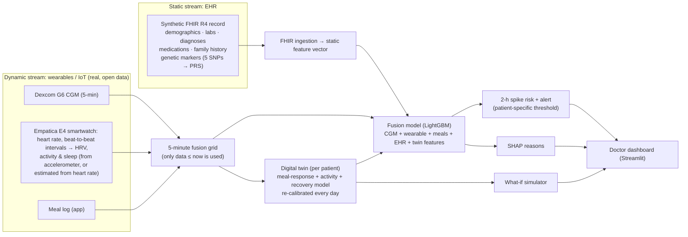
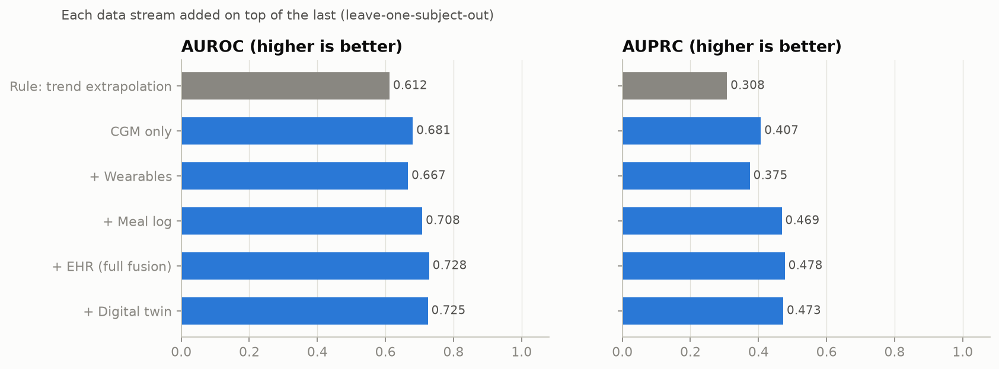
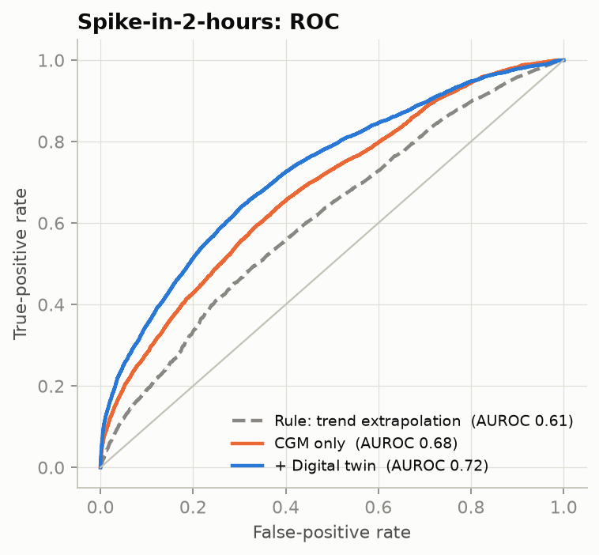
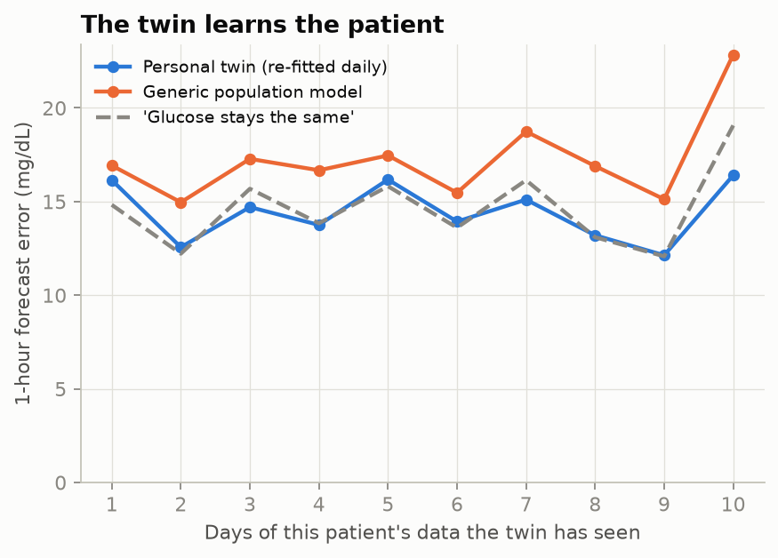
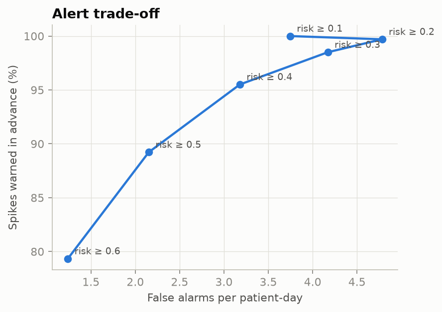
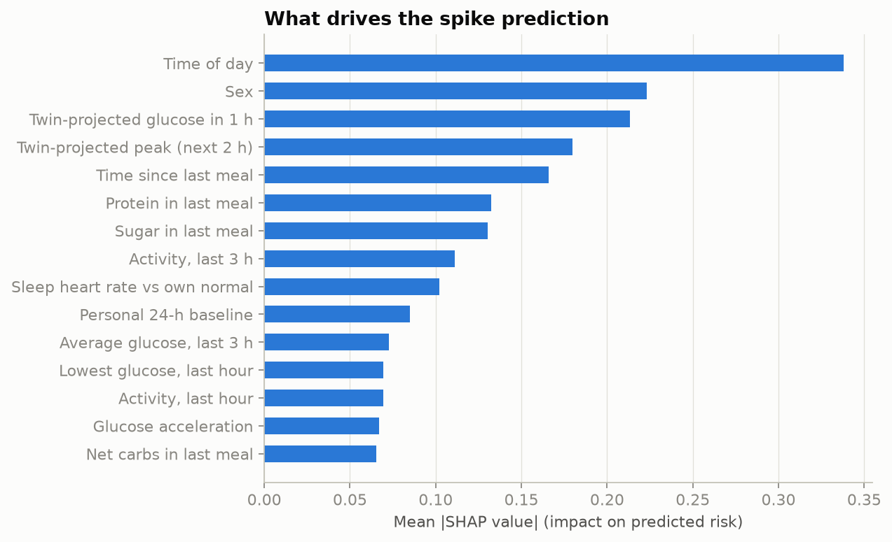
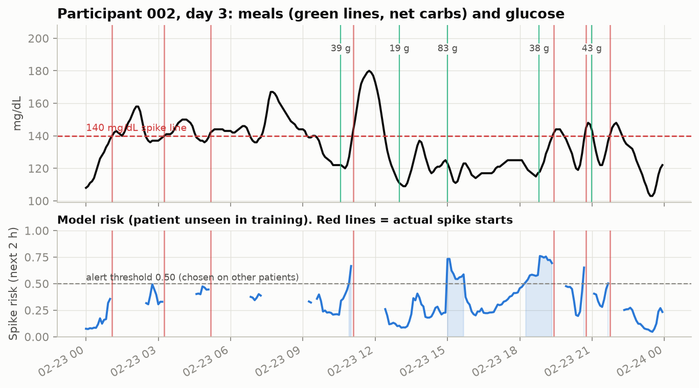
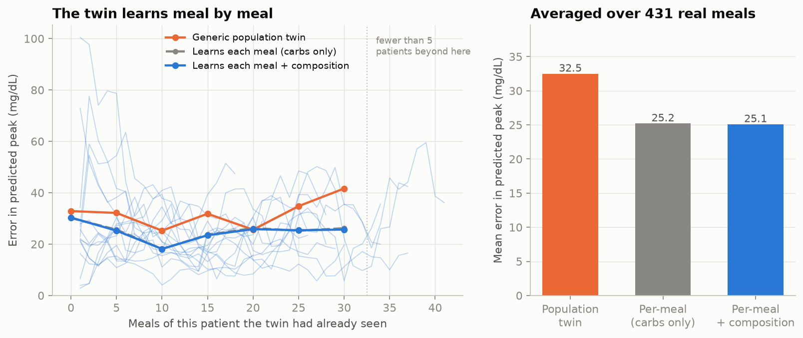

# GlucoTwin

### A patient digital twin that warns of glucose spikes 2 hours ahead by fusing health records with wearable data

> Happiest Health **Digital Twin Challenge 2026** · Phase 1: Prototype & Code Submission

---

## 1. Team details

| | |
|---|---|
| **Team name** | Uno |
| **Team leader** | Varsha B S Acharya |
| **College** | RV University, Bengaluru |
| **Team size** | 1 |

## 2. Project title

**GlucoTwin: EHR + wearable fusion for 2-hour-ahead glucose-spike prediction, with a calibrated per-patient digital twin and a doctor dashboard**

## 3. Problem statement and healthcare use case

India has an estimated **101 million people with diabetes and 136 million with prediabetes** (ICMR-INDIAB national survey, 2023). In prediabetes, repeated **post-meal glucose spikes** are an early, modifiable warning sign, but a doctor sees the patient a few times a year, and a CGM only reports a spike once it is already happening.

**Use case.** A doctor (or care team) monitors a panel of prediabetic patients who wear a CGM and a smartwatch and log meals in an app. GlucoTwin:

1. **Mirrors** each patient: one virtual patient built from their health record (static) and their live sensor streams (dynamic).
2. **Predicts** an adverse event: *glucose will cross 140 mg/dL within the next 2 hours*. 140 mg/dL is the 2-hour OGTT cut-off for impaired glucose tolerance.
3. **Explains** each alert in plain language, e.g. "large lunch logged · short sleep last night · low activity".
4. **Simulates** what-ifs with the patient's own calibrated physiology, e.g. *"if she walks 15 minutes after lunch, her projected peak falls from 168 to 152 mg/dL"*.

## 4. Demo video

▶️ **✏️ unlisted YouTube link** (15-20 minutes)

## 5. How it works



Full diagram (PDF): [`docs/architecture.pdf`](docs/architecture.pdf)

### Clock alignment: making sure the streams line up
The CGM, the wristband and the phone meal log each keep their own clock, and in the public dataset they don't always agree. Before modelling, `src/align.py` checks each person and prints a report (also in the dashboard's *Data & compliance* page):
- **Wristband vs CGM.** Heart rate and glucose are both quiet at night and busy by day. The shift that best lines up the two 24-hour patterns, pooled over all participants, gives the wristband's clock offset.
- **Meal log vs CGM.** Glucose should rise 40–80 min after a carb meal. Meal-time offsets of ±2 h are tested, and one is kept only if it clearly strengthens that rise (for example, meals logged an hour late).
- **Meal-log coverage.** If a person's logged meals fall outside their CGM recording, the meal log is marked *unavailable*, so the model doesn't read it as "never ate".

On a test copy with deliberately broken clocks (wristband +5 h, meals logged an hour late, one log from another fortnight), the step recovered every offset exactly. AUROC went back from the misaligned level to within 0.01 of the clean data.

### The digital twin, in one equation
For each patient, glucose is modelled as

$$G(t) = G_{base}(t) + k\sum_{meals} C_i\,h(t-t_i;\,t_p) - a\,A(t) + D\,e^{-\Delta t/t_r}$$

where $h$ is a hump-shaped meal response that peaks at $t_p$ minutes, $A$ is smoothed wrist activity, and $D$ is any unexplained deviation, which fades with recovery time $t_r$.
The four numbers **(k, tp, a, tr)** are the patient's twin: carb sensitivity, time-to-peak, activity benefit, and recovery.
- They start from population values and are **re-fitted every day on that patient's past data only** (MAP estimation with a population prior), so the twin learns the person.
- The twin then feeds the ML model with forecast features (projected peak, projected rise) and powers the what-if simulator.

## 6. Technical stack and models

| Layer | Tools |
|---|---|
| Language | Python 3.10+ |
| Data | pandas, NumPy (chunked streaming of multi-GB sensor CSVs) |
| EHR interoperability | HL7 **FHIR R4** bundles (LOINC, SNOMED CT, RxNorm codes), the standard used by India's ABDM |
| Digital twin | Physiological model fitted with SciPy `least_squares` (bounded MAP with population prior) |
| Prediction | **LightGBM** gradient-boosted trees (handles missing sensor data natively) |
| Explainability | SHAP (TreeSHAP), global and per-alert |
| Validation | **Leave-one-subject-out** cross-validation; alert thresholds chosen by inner CV on training patients only |
| Dashboard | Streamlit + Plotly |

**Features (≈60):**
- **CGM:** level, 15/30/60-min change, trend, acceleration, variability, personal baseline.
- **Wearables:** heart rate, HRV (RMSSD), activity over 15 min, 1 h and 3 h, previous-night sleep duration, sleep heart rate and sleep HRV. Skin temperature and EDA are used when downloaded.
  - Each signal is measured **relative to that person's own normal** (their trailing 3 days, past data only). Raw levels differ far more between people than within a person, so raw values mostly tell a model *who* someone is, which doesn't carry over to a new patient.
  - Activity comes from the accelerometer when available. Otherwise it is estimated from heart rate above the person's resting level (`src/load_data.py`), which works with any watch that reports heart rate.
- **Meals:** time since the last meal, its carbs, sugar, fat, protein and fibre, and carbs in the last 3 h.
- **EHR:** age, sex, BMI, HbA1c, fasting glucose, lipids, blood pressure, diagnoses, medications, family history, polygenic risk score.
- **Twin:** projected 2-h peak, projected rise, projected glucose in 1 h, and the meal effect still active. Only the twin's time-varying *forecasts* go into the model. Its personal parameters are constant within a person, so they would act as an ID card for that person.

## 7. Results

Run on the BIG IDEAs dataset: 16 participants, about 38,000 five-minute rows, of which 22% are followed by a spike within 2 h. **Every number comes from a model that never saw the patient it is scoring** (leave-one-subject-out). Alert thresholds were chosen on the training patients only.

| Data used | AUROC | AUPRC | Spikes warned in advance | Median warning | False alarms / day |
|---|---|---|---|---|---|
| Rule: CGM trend extrapolation | 0.612 | 0.308 | 99% | 75 min | 6.8 |
| CGM only (ML) | 0.680 | 0.407 | 90% | 10 min | 1.7 |
| + Wearables | 0.658 | 0.364 | 88% | 10 min | 2.3 |
| + Meal log | 0.717 | 0.477 | 89% | 40 min | 2.1 |
| **+ EHR (full fusion)** | **0.733** | **0.490** | **86%** | **40 min** | **1.9** |
| + Digital twin forecasts | 0.721 | 0.476 | 87% | 40 min | 2.0 |

*AUPRC baseline (random guessing) = 0.22. "Spikes warned in advance" = share of spikes preceded by at least one alert in the 2 hours before.*

> **Reproducibility note.** The table above is the original run. Re-running the identical pipeline on
> LightGBM 4.7 / numpy 2.5 / pandas 3.0 / Python 3.14 gives **0.728** for full fusion, with every ML row
> moving by 0.005-0.009. Gradient boosting is not bit-reproducible across library versions. The rule
> baseline (0.612 / 0.308 / 6.8 false alarms a day), which uses no model, reproduces exactly, as does the
> clock alignment (016 shifted +105 min, 015's meal log unused) - so this is library drift, not a data
> difference. Conclusions are unchanged.

**What the results show**
- **Fusion helps.** Going from glucose alone to the full fusion of glucose, wearables, meals and health record raises AUROC from 0.680 to **0.733** and AUPRC from 0.407 to **0.490**. The meal log adds the most.
- **Fewer false alarms than a basic CGM alarm.** Extrapolating the glucose trend catches almost every spike but raises **6.8 false alarms a day**, which leads to alarm fatigue. The fusion model warns of 86% of spikes with **1.9 false alarms a day**, a median of 40 minutes ahead.
- **Wearables alone don't add over CGM** in this build, because without the accelerometer, activity is estimated from heart rate. They contribute inside the full fusion.
- **The digital twin's value is personalisation and simulation.** Adding its forecasts as model inputs didn't improve the score further (0.721 vs 0.733; with 16 people this difference is within noise). The twin is what lets a doctor ask *"what if she walks after lunch?"*, and it was not tuned to improve the score.

**Clock alignment on the real data:** the wristband and CGM clocks agreed, so no shift was needed. One participant's meal times were shifted (016, +105 min). One participant's meal log (015) fell entirely outside their CGM recording, so it was marked unavailable.

| | |
|---|---|
|  |  |
|  |  |
|  |  |

## 8. A twin that learns meal by meal — and a women's-health module

The twin in section 5 is re-fitted **once a day**. This part makes it learn **meal by meal**, and lets it
use *what* was eaten, not just how many grams of carbohydrate.

> Before a meal the twin predicts the peak. After the meal it compares with the real CGM peak, and learns.

For every meal, in time order:

1. **Predict** the post-meal peak from parameters fitted on that patient's **earlier meals only**.
2. **Compare** with the peak the CGM actually recorded in the next 3 hours.
3. **Re-fit**, so the next meal is predicted by a slightly better twin.

Two extra per-person parameters let the composition of a meal change its response:

$$\text{amplitude} \times \frac{1}{1 + f_b \cdot \frac{\text{fibre}}{\text{net carbs}+1}}
\qquad
\text{time-to-peak} \times \left(1 + f_d \cdot \frac{\text{protein}+\text{fat}}{\text{net carbs}+10}\right)$$

**Both priors are zero.** The twin starts from "composition makes no difference" and only moves if that
person's own meals say otherwise, so this is a real test rather than a guaranteed win.

### Results: 431 real meals, 15 participants

Participant 015's food log falls outside their CGM recording (section 10), so they contribute no meals.
Every number comes from parameters fitted on earlier meals only.

| Twin | Mean error in predicted peak | Later half of each person's meals | Median |
|---|---|---|---|
| Generic population twin | 32.5 mg/dL | 35.2 mg/dL | 21.1 |
| **Learns each meal (carbs only)** | **25.2 mg/dL** | **24.8 mg/dL** | 18.3 |
| Learns each meal + food composition | 25.1 mg/dL | 24.7 mg/dL | 18.0 |



**What the results show**

- **Per-meal learning works.** It cuts the error in the predicted peak by **7.3 mg/dL** (32.5 → 25.2, a
  22% reduction; bootstrap 95% CI **[4.1, 10.6]**, so clearly better than chance). It helped **13 of 15**
  patients. The gap widens with more meals: by the later half of a person's meals the generic twin is at
  35.2 mg/dL while the learning twin holds at 24.8.
- **Food composition added almost nothing here, and we are not claiming it did.** The improvement is
  **0.12 mg/dL**, with a 95% CI of **[−0.01, +0.25]** that includes zero. It is kept only because it is
  not worse (it helped 13 of 15 patients, by a trivial amount). Two likely reasons: fibre is barely
  recorded for several participants (3% of meals for 001, 11% for 002, and participant 003's food log
  has **no fibre or fat column at all**), and 15 people is too few to fit two extra parameters well.
- **It does not help everyone.** For participants 009 and 010 the per-meal twin was *worse* than the
  population twin (26.7 → 33.4 and 26.7 → 27.5 mg/dL). With ~20-40 meals each, a few unusual meals can
  pull the fit the wrong way.

### Eating order: honest about what this is

The dashboard's **Plan a meal** panel offers *Carbs first · Mixed · Vegetables & protein first*.

**This is not learned from this dataset.** The BIG IDEAs food logs record what was eaten and when, never
in what order, so there is nothing here to learn it from. The effect is a single literature-based constant
(`config.ORDER_PEAK_MULTIPLIER`), taken from Shukla AP, Iliescu RG, Thomas CE, Aronne LJ, *Food Order Has a
Significant Impact on Postprandial Glucose and Insulin Levels*, **Diabetes Care 2015;38(7):e98-e99**
([doi:10.2337/dc15-0429](https://doi.org/10.2337/dc15-0429)) — a crossover study in **11** adults with type 2
diabetes reporting 29-37% lower glucose at 30-60 min when vegetables and protein came before carbohydrate.

We apply **25%** to the peak rise, deliberately below that study's 29-37%, because n=11, the meal was a
Western one, and this cohort is not diabetic. The dashboard labels it on screen:

> *Order effect: based on published research, not learned from this dataset. With order logging, the twin
> would personalise this too.*

The Indian meal menu (`data/indian_meals.csv`, 10 common meals) is **approximate**, compiled from typical
household servings. We could not access the Indian Food Composition Tables (IFCT 2017) to verify each dish,
and the file says so in its header rather than presenting the numbers as exact. Edit that one file to
correct them; nothing else changes.

### Proving there is no leakage

The whole claim rests on the twin never seeing the future, so that is tested rather than asserted:

```bash
python scripts/check_no_leakage.py
```

It deletes future meals and future glucose and checks that neither the forecast nor the fitted parameters
move. On the real data: **192 forecast probes and 53 re-fit probes, all unchanged.**

> This section is reported **separately** from the fusion-model table in section 7. The per-meal twin does
> not feed the LightGBM model, and none of the numbers in section 7 depend on it.

### Women's-health module: menstrual cycle phase

Insulin sensitivity falls in the **luteal** phase, so the same meal tends to peak higher in the second
half of the cycle. For a tool aimed at prediabetes in India — where the people being screened are very
often women — that is a real clinical factor, and it is missing from most glucose models.

**It cannot be learned from this dataset, and — importantly — it does not even apply to this cohort.**
Three hard facts:

| | |
|---|---|
| **Study inclusion criterion** | *"subjects aged 35-65 years, inclusive, **including only post-menopausal females**"* ([PhysioNet](https://physionet.org/content/big-ideas-glycemic-wearable/)) |
| A menstrual cycle | ~28 days |
| Longest recording in this dataset | **9.9 days** (the 9 women: 7.7 – 9.9 days) |
| Cycle / hormone / menstrual columns in the 65 raw files | **none** |

**All 9 women in this dataset are post-menopausal and do not menstruate.** So the cycle control is not
a claim about any patient here — it is a **capability demonstration**, shown behind an expander that
says exactly that, demonstrating how the twin would adjust for a premenopausal patient. Like the
eating-order effect it is **one labelled constant the doctor sets by hand** (`config.CYCLE_K_MULTIPLIER`),
and it is never used in any accuracy number.

- Luteal phase: carb sensitivity **×1.15**, baseline **+3 mg/dL**. Follicular is the reference.
- Chosen conservatively. The insulin-sensitivity drop reported in the literature is much larger
  (5.03 → 2.22, >50%, n=12), but that is *S*<sub>i</sub>, not a post-meal peak; CGM studies show
  mean-glucose differences of only a few mg/dL. We sit deliberately between the two, at the low end.

Evidence: [Valdes & Elkind-Hirsch, *J Clin Endocrinol Metab* 1991](https://pubmed.ncbi.nlm.nih.gov/10071420/)
(n=12) · [Dexcom G6 CGM across 149 cycles](https://www.ncbi.nlm.nih.gov/pmc/articles/PMC10421863/)
(glucose highest in luteal, lowest in late-follicular) ·
[Apple Heart & Movement Study, 1,982 cycles](https://appleheartandmovementstudy.bwh.harvard.edu/trends-in-glucose-levels/)
(time-in-range 68.5% follicular vs 66.8% luteal).

In the dashboard, for patient P-005 eating rice + dal + sabzi:

| Cycle phase | Carbs first | Mixed | Vegetables & protein first |
|---|---|---|---|
| Follicular (reference) | 146 🔴 | 142 🔴 | **135** 🟢 |
| Luteal | 153 🔴 | 148 🔴 | **141** 🔴 |

The teaching point, for a premenopausal patient: in the follicular phase, eating the vegetables first
keeps her under 140. **In the luteal phase the same strategy is no longer enough.** Same woman, same
meal, same advice — different answer depending on where she is in her cycle.

**The dataset that would let the twin actually learn this** is
[mcPHASES](https://www.physionet.org/content/mcphases/1.0.0/) (PhysioNet, restricted access): 42 women,
**~3 months each** — long enough for three full cycles — with a Dexcom G6, a Fitbit Sense, and **daily
LH, E3G and PdG urine assays with labelled cycle phases**. With that, `fb`/`fd`-style per-person cycle
parameters could be fitted the way carb sensitivity is today, instead of assumed. See *Future work*.

### A women-only cohort: what actually happens with 9 participants

We also re-ran the entire pipeline on the **9 female participants only**:

```bash
python run_pipeline.py --women      # writes to artifacts_women/, main results untouched
```

| Data used | AUROC (all 16) | AUROC (9 women) | AUPRC ÷ baseline (16) | AUPRC ÷ baseline (9 women) |
|---|---|---|---|---|
| Rule: trend extrapolation | 0.612 | 0.587 | 1.40 | 1.46 |
| CGM only | 0.681 | 0.607 | 1.85 | 1.55 |
| + Wearables | 0.667 | 0.596 | 1.71 | 1.47 |
| **+ Meal log** | 0.708 | **0.667** | 2.13 | 2.17 |
| + EHR (full fusion) | **0.728** | 0.654 | 2.17 | 2.11 |
| + Digital twin | 0.725 | 0.655 | 2.15 | 2.10 |

21,941 rows from 9 people, spike-ahead rate **15.1%** (against 22.0% for all 16), so raw AUPRC is not
comparable between the two cohorts — it is shown divided by each cohort's own baseline.

**What this shows, honestly:**

- **Discrimination gets worse**: full fusion falls from 0.728 to **0.654**. With 9 subjects, leave-one-
  subject-out trains on 8 people, and one of those 9 (participant 015) has no usable meal log at all.
- **The ranking changes**: on this cohort the best model is **+ Meal log (0.667)**, and *adding the EHR
  made it worse* (0.654). The "every stream helps" result from section 7 does **not** replicate here.
- **The meal log still carries the signal.** Relative to each cohort's own spike rate, the meal-log model
  is the strongest in both (2.13× and 2.17× baseline).
- **The per-meal twin replicates.** On 218 meals from the women, peak error fell **30.1 → 22.9 mg/dL**
  (24% better), close to the 22% on the full cohort.

**This is a cohort-size result, not a statement about women.** Nine people is too few to conclude
anything about sex differences in glucose prediction, and we do not claim one. We ran it because it is
the honest way to answer "what if this were a women's tool?" — and the answer is that the dataset is too
small to support it, which is why the main results keep all 16 participants and the women's-health
contribution is the cycle-phase module above.

## 9. Doctor dashboard

```bash
streamlit run app/dashboard.py
```
- **Ward overview:** every patient sorted by risk, with status icon and label (🔴 Alert / 🟠 Watch / 🟢 Stable / 🩸 In spike), glucose and trend arrow, last meal, and the main reason.
- **Patient twin:**
  - health-record card and alert banner with reasons
  - a multi-day timeline of glucose, risk, HR, HRV, activity and sleep
  - the twin's personal parameters
  - the **what-if simulator** (meal size × post-meal walk)
  - **🍽 Plan a meal** (section 8): pick a common Indian meal **or build your own** (enter carbs,
    fibre, protein and fat for any food), choose an eating order, and see the projected
    peak for *carbs first* / *mixed* / *vegetables & protein first*, with whether each crosses 140
  - **Describe it in words** *(optional)*: type "2 rotis, dal and a bowl of curd" and Claude estimates
    carbs/fibre/protein/fat, which you can then edit. Needs an `ANTHROPIC_API_KEY`; without one the
    option is hidden and nothing else changes. It only fills in those four numbers - the physiology is
    still the patient's own twin, and no reported number depends on it.
  - **After the meal:** for every real meal, what the twin predicted *before* it was eaten, what the CGM
    actually recorded, and what a generic twin would have said instead
- **Model performance:** the ablation, ROC, alert trade-off and SHAP figures, plus the per-meal learning
  results and a per-patient table of which nutrient columns each food log really contains.
- **Data & compliance:** data provenance and a viewer for each patient's FHIR record.
- A **replay clock** walks through the recorded week as if live. Predictions never use data after the clock time.

Live demo: ✏️ Streamlit Community Cloud link

## 10. Data and sandbox compliance (DPDP Act / HIPAA)

No real patient records are used.

| Stream | Source | Real or synthetic |
|---|---|---|
| CGM, smartwatch (heart rate, beat-to-beat intervals), food logs, sex, HbA1c | [BIG IDEAs Lab Glycemic Variability and Wearable Device Data](https://physionet.org/content/big-ideas-glycemic-wearable/), PhysioNet, **open access** (Open Data Commons Attribution License v1.0) | Real, de-identified |
| Age, labs, diagnoses, medications, family history, genetic markers | Generated by `src/ehr.py`, consistent with each person's real HbA1c | **Synthetic** |

The raw dataset is not redistributed in this repository. Download it from PhysioNet (see below).

**Citations**
- Dataset: Cho, P., Kim, J., Bent, B., & Dunn, J. (2023). *BIG IDEAs Lab Glycemic Variability and Wearable Device Data* (version 1.1.2). PhysioNet. https://doi.org/10.13026/zthx-5212
- Original study: Bent, B., Cho, P.J., Henriquez, M. et al. Engineering digital biomarkers of interstitial glucose from noninvasive smartwatches. *npj Digital Medicine* 4, 89 (2021). https://doi.org/10.1038/s41746-021-00465-w
- PhysioNet: Pollard, T. et al. (2026). PhysioNet as a global platform for biomedical research. *Nature Health*. https://doi.org/10.1038/s44360-026-00096-z
- Prevalence figures: Anjana, R.M. et al. Metabolic non-communicable disease health report of India: the ICMR-INDIAB national cross-sectional study (ICMR-INDIAB-17). *Lancet Diabetes & Endocrinology* 11, 474–489 (2023).

## 11. Run it yourself

```bash
python -m venv venv
venv\Scripts\activate            # Windows   (macOS/Linux: source venv/bin/activate)
pip install -r requirements.txt

python scripts/download_data.py  # core files only (~360 MB) from PhysioNet into data/raw/
python run_pipeline.py           # ~20-40 min on first run; sensor tables are cached afterwards
streamlit run app/dashboard.py
```

No download yet? Try the lookalike demo data (same file format, simulated values):
```bash
python scripts/make_demo_data.py
python run_pipeline.py --demo
streamlit run app/dashboard.py
```

### Repository layout
```
config.py              all settings (spike threshold, horizon, twin priors, model params)
run_pipeline.py        one command: load → EHR → features → twin → train → evaluate → figures
src/load_data.py       streams multi-GB sensor CSVs into 5-minute bins (no future leakage)
src/features.py        CGM / wearable / sleep / meal features + the 2-hour spike label
src/ehr.py             synthetic FHIR R4 records + ingestion back to features
src/twin.py            the per-patient digital twin: fitting, forecasting, what-if simulation
src/meal_twin.py       per-MEAL learning twin + food composition + eating order + cycle phase (section 8)
src/train.py           LOSO training, inner-CV alert thresholds, ablation
src/evaluate.py        AUROC/AUPRC + event-level metrics (sensitivity, lead time, false alarms/day)
src/figures.py         figures for README and slides
app/dashboard.py       the doctor dashboard
data/indian_meals.csv  the "Plan a meal" menu - APPROXIMATE values, edit this one file to change them
scripts/               demo-data generator, architecture diagram, leakage check
docs/                  architecture diagram and presentation (PDF)
artifacts/             trained models, metrics, figures, EHR bundles (used by the dashboard)
```

Check that the per-meal twin never sees the future:
```bash
python scripts/check_no_leakage.py          # add --demo to run it on the demo data
```

Re-run on the women-only cohort (section 8). It writes to `artifacts_women/` and leaves the main
results and the dashboard untouched:
```bash
python run_pipeline.py --women
```

## 12. Honest limitations
- **Small cohort.** The cohort has 16 adults with normal to prediabetic HbA1c. Results show feasibility, not clinical validity.
- **Synthetic EHR.** Apart from sex and HbA1c, the EHR is synthetic, so the EHR's contribution here demonstrates the fusion *pipeline*. It is not evidence about real records.
- **Clock alignment uses each participant's own data.** This is a one-off calibration, like syncing devices at setup. It happens before the leave-one-subject-out evaluation.
- **Unlogged meals.** Meals that aren't logged can't be anticipated. The model can only warn about spikes it has signals for.
- **Estimated sleep and activity.** Sleep is estimated from heart rate and movement, not polysomnography. In this build, activity is estimated from heart rate because the accelerometer files (~13 GB) were not downloaded. Heart rate also rises with stress and after meals, so this proxy is approximate.
- **What-if simulator.** It is decision support from a simple personalised model, not a prescription.
- **Eating order is not learned from this data.** The food logs never record the order food was eaten in,
  so the order effect in *Plan a meal* is a fixed constant taken from one published crossover study of
  11 adults with type 2 diabetes (section 8), applied conservatively. It is an illustration of what the
  twin *could* personalise if order were logged, not a finding from this cohort.
- **The Indian meal menu is approximate.** It was not verified against IFCT 2017 dish by dish.
- **The cohort is post-menopausal, so the cycle module does not apply to it.** The BIG IDEAs study
  enrolled only post-menopausal females, the recordings are 7-10 days against a ~28-day cycle, and no
  file records cycle or hormone data. The control is a labelled capability demonstration, not a claim
  about any patient here, and it never enters an accuracy number (section 8).
- **The women-only cohort is too small to conclude anything about sex differences.** Nine participants,
  one of whom has no usable meal log. Its weaker numbers reflect cohort size, not a finding about women.
- **Food composition did not measurably help.** Adding fibre and fat/protein terms changed the per-meal
  error by 0.12 mg/dL, with a confidence interval that includes zero (section 8). Fibre is sparsely
  logged, and one participant's food log has no fibre or fat column at all.
- **Clinical deployment.** That would need prospective validation, regulatory review, and integration with ABDM-compliant consent flows.

## 13. Future work
- **A cycle-aware twin learned from data, not assumed.** [mcPHASES](https://www.physionet.org/content/mcphases/1.0.0/)
  (PhysioNet, restricted access) follows 42 women for ~3 months each with a Dexcom G6, a Fitbit Sense
  and daily LH/E3G/PdG assays with labelled cycle phases. Three months is three full cycles per woman,
  so the luteal adjustment that is a fixed constant here could be fitted **per patient**, exactly as
  carb sensitivity is today. That is the right dataset for the women's-health module; this one is
  post-menopausal by design and 8 days long.
- Real EHRs through ABDM/FHIR consent flows.
- Federated or on-device training, so data stays on the patient's phone.
- Multi-day forecasting and hypoglycaemia alerts.
- Physics-informed neural networks for the twin core.
- Closed-loop personalised nutrition and medication-timing advice.

## 14. Presentation

📑 [`docs/presentation.pdf`](docs/presentation.pdf) — 21 slides, exported from
[`docs/presentation.html`](docs/presentation.html), which is the live deck: open it in a browser,
arrow keys to navigate, **N** for speaker notes, **F** for fullscreen. Slides marked *LIVE DEMO*
are the points where the walkthrough switches to the running dashboard.

## 15. License

Code: **MIT License**, see [`LICENSE`](LICENSE).
Data: BIG IDEAs Lab dataset under the Open Data Commons Attribution License v1.0 (not redistributed here).
